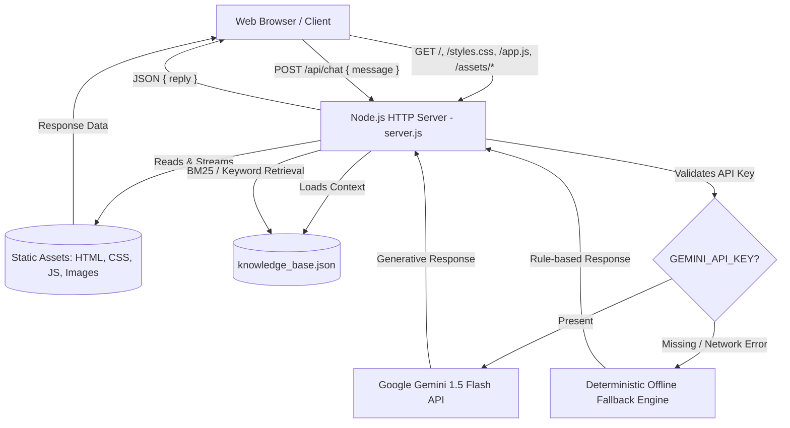

# Rajesh S I — Freelance Portfolio & RAG Chatbot

An interactive personal portfolio website for Rajesh S I, a freelance Data Analyst and Workflow Automation Specialist based in Bangalore. The project showcases case studies, interactive UI simulators, tactile claymorphic aesthetics, and an embedded full-stack RAG (Retrieval-Augmented Generation) assistant powered by Google Gemini (with an automatic offline fallback engine).

---

## 1. Project Overview & Purpose

The portfolio serves as an interactive hub for client inquiries, technical credential verification, and demonstration of data engineering capabilities.

### Key Features

* **Tactile Claymorphism UI**: Custom tactile design using earthy tones (terracotta, olive, and sand) along with analog grain overlays.


* **Interactive Data Simulator**: An in-browser ETL simulation demonstrating data cleaning, record normalization, and real-time metric recalculation.


* **Project Categorization**: Filterable case studies with smooth native transitions.


* **Digital Signature & Inquiry Form**: Interactive client inquiry submission form with dynamic signature signing and direct `mailto` integration.


* **Full-Stack RAG Chatbot**: An embedded AI chatbot that uses in-memory keyword/BM25 scoring against a domain-specific knowledge base. It calls Google Gemini (`gemini-1.5-flash`) when an API key is provided, and gracefully defaults to an offline local engine if unconfigured or unreachable.


---

## 2. System Design & Architecture

### System Architecture Diagram



### Component Breakdown

1. **Frontend (`index.html`, `styles.css`, `app.js`)**
* **`index.html`**: Semantic markup structured into Hero, Services, Projects/Simulators, About, Credentials, and Contact/Sign sections.


* **`styles.css`**: Design tokens, soft inset/drop shadows, responsive layouts, analog noise overlays, and custom UI components.


* **`app.js`**: Controls skeleton loading states, project filtering via `document.startViewTransition`, the ETL simulator cycle, form input verification, clipboard helpers, and client-side chatbot communication.


2. **Backend Server (`server.js`)**
* Pure Node.js HTTP server (zero external web frameworks).


* Static asset server supporting `.html`, `.css`, `.js`, `.json`, `.png`, `.jpg`, `.jpeg`, `.svg`, `.ico`, and `.pdf`.


* Environment parser loading `.env.local` or `.env`.


* Security filters rejecting payloads exceeding 50 KB, messages over 600 characters, and common prompt injection patterns.


3. **Data & RAG Layer (`server.js`, `data/knowledge_base.json`)**
* Implements TF/keyword matching over structured domain chunks (`title`, `content`, `keywords`).


* Constructs a grounded system prompt supplied to Google Gemini.


* Deterministic local response system ensuring uninterrupted uptime even without third-party network access.


---

## 3. Visual Assets & Media

The repository contains original visual assets representing the tactile claymorphic theme:

| Asset Name | Repository File | Preview |
| --- | --- | --- |
| **Hero Data Analytics 3D Art**<br> | `assets/clay-analytics.jpg` (or `hero_clay_data_1792339841303.jpg`)

 | [cite: 4] |
| **Workflow Automation Engine 3D Art**[cite: 3, 5] | `assets/clay-workflow.jpg` (or `clay_automation_cube_1792339841303.jpg`)[cite: 3, 5] | [cite: 3] |

---

## 4. Hardware & Pin-to-Pin Wiring Information

*Status: **Not Applicable / Pure Software Repository***

* **Component Details**: No microcontrollers, SBCs (Single Board Computers), sensors, actuators, or peripheral hardware modules are present or defined in this codebase.


* **Wiring Mapping**:

| Component Signal / Pin | Connected Board Pin | Purpose |
| --- | --- | --- |
| *None* | *None* | *Software-only web repository; no hardware wiring required.*<br> |

*(Note: If you plan to extend this project to an embedded physical device such as an ESP32 or Raspberry Pi kiosk/display, connect over standard Wi-Fi or HTTP using REST requests to `http://<server-ip>:3000/api/chat`.)*

---

## 5. Setup, Configuration & Installation

### Prerequisites

* **Node.js**: Version 18.0.0 or higher


* **npm**: Version 8.0.0 or higher[cite: 6, 7]

### Installation

1. **Clone the repository:**
```bash
git clone <repository-url>
cd <repository-directory>

```


2. **Install dependencies:**
```bash
npm install

```


(Note: The runtime server uses core Node.js packages; dependencies in `package.json` include React and TypeScript type definitions for modular frontend tooling).


3. **Configure Environment Variables:**
Copy or edit `.env.local` in the project root[cite: 1, 8]:
```env
# Google Gemini API Key (Get a free key at https://aistudio.google.com/)
GEMINI_API_KEY=your_gemini_api_key_here

# Optional port configuration (defaults to 3000)
PORT=3000

```


> **Note**: If `GEMINI_API_KEY` is left blank, the application automatically operates using its built-in local retrieval fallback engine without failing.
> 
> 


---

## 6. Running the Application

### Option A: Full Application (Recommended)

Runs the HTTP file server and the live `/api/chat` RAG endpoint:

```bash
npm start

```

*or*

```bash
node server.js

```

Open your browser and navigate to:

```text
http://localhost:3000

```

### Option B: Static Preview Only (Without Node.js Server)

If you only need to inspect the UI design:

1. Open the project directory in VS Code.


2. Right-click `index.html` and select **Open with Live Server** (or open `index.html` directly in any web browser).


3. The chatbot will gracefully route queries to the built-in browser-side fallback knowledge base.


---

## 7. Project File Structure

```text
├── .env.local                    # Environment configuration & API credentials[cite: 1]
├── app.js                        # Client-side UI interactions and chatbot fallbacks[cite: 2]
├── assets/                       # Image assets, profile pictures, and 3D clay illustrations[cite: 5]
├── data/
│   └── knowledge_base.json       # Structured RAG knowledge base chunks[cite: 8]
├── index.html                    # Main portfolio website layout[cite: 5]
├── package.json                  # Project metadata and run scripts[cite: 6]
├── package-lock.json             # Locked dependency versions[cite: 7]
├── server.js                     # Core Node.js HTTP server and /api/chat RAG pipeline[cite: 8]
├── styles.css                    # Tactile claymorphic styling & responsive design tokens[cite: 9]
└── tsconfig.json                 # TypeScript compiler configuration[cite: 10]

```

---

## 8. License

This project is open-source under the [MIT License](https://www.google.com/search?q=package.json)[cite: 6].
